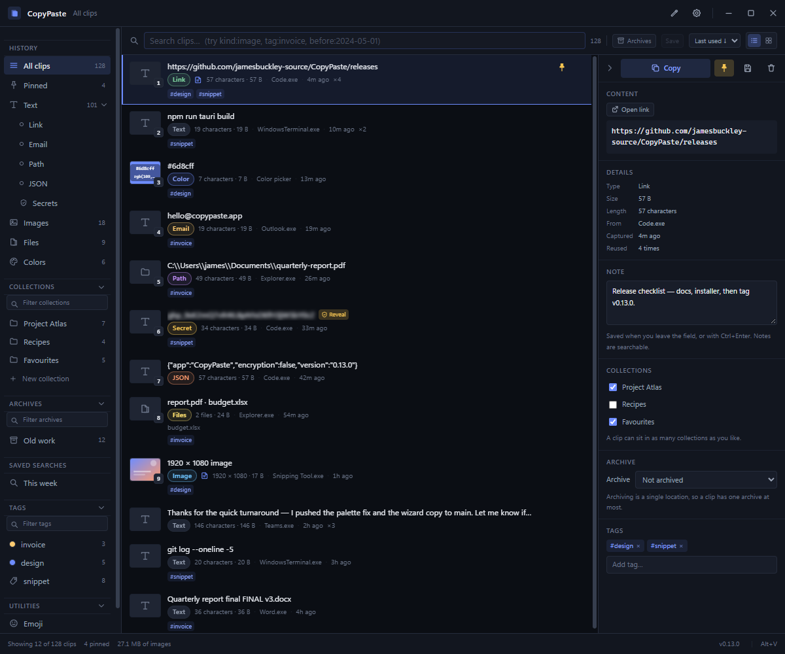
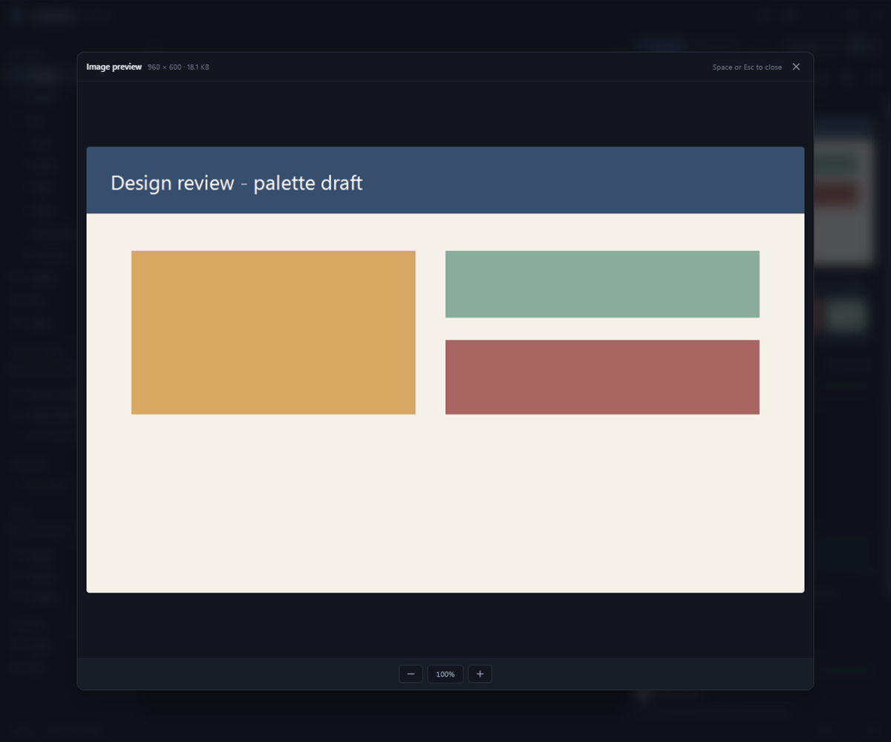
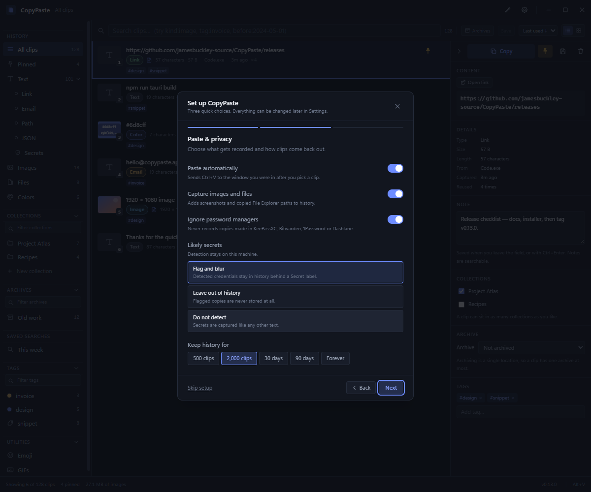

# CopyPaste

A clipboard history manager for Windows: Tauri 2 + React 19 + TypeScript + Tailwind CSS 4.

Everything stays on your machine. Clip contents are stored locally in SQLite; the only requests the
app makes are for a copied picture's own source file, a link's preview picture, GIPHY (with your key),
and its own update check — each described in [Security model](#security-model).

<p align="center">
  <a href="https://github.com/jamesbuckley-source/CopyPaste/releases/latest/download/CopyPaste_x64-setup.exe">
    
  </a>
</p>

<p align="center"><sub>Per-user NSIS installer · no admin prompt · Windows 10 and 11</sub></p>

## Download

**[Download CopyPaste for Windows](https://github.com/jamesbuckley-source/CopyPaste/releases/latest/download/CopyPaste_x64-setup.exe)**
— a per-user NSIS installer, no elevation prompt, around 10 MB.

All versions, notes and artefacts are on the
[releases page](https://github.com/jamesbuckley-source/CopyPaste/releases/latest). Installed copies
update themselves: *Settings → About* checks GitHub once a day and installs signed releases in
place.

## Screenshots



*The history view: search and filters on the left, clips in the middle, and the preview pane with
the colour scheme, notes, collections, archives and tags on the right. The **Add clip** button sits
in the toolbar, and the version number at the bottom right is also the manual update-check button.*



*`Space` opens the selected clip over a dimmed history. Images get zoom controls at the bottom; text
clips open in a larger editor.*



*The first-run wizard covers the summon hotkey, paste and privacy choices, secret handling,
retention, theme and sounds. It can be re-run from Settings at any time.*

## What it does

- **Captures** text, images and copied file lists as you copy them.
- **Drops in** files: dragging files from Explorer onto the window creates an image clip, a text clip or a file-list clip.
- **Keeps GIFs and videos moving** — copying an image from a browser recovers the source GIF or MP4
  and copies it back as a file, so every frame survives; the recovered asset is also what the app
  previews. Pasting the movie's own address does the same. A video copied this way also carries the
  address it came from as plain text, because plenty of targets refuse a dropped file and would
  otherwise paste nothing.
- **Recognises color codes** — a copied hex or `rgb()` value becomes a swatch with the code laid
  over it, with its own sidebar entry. Screenshot clips read their own colour scheme automatically,
  keeping the accents rather than a wall of greys.
- **Finds faces** in image clips with a detector that runs locally, so screenshots of people can
  be filtered as **Images → People**; only a count is stored, nothing is uploaded or compared.
- **Summons** with a global hotkey (`Alt+V` by default) as a frameless overlay, or from the tray.
- **Searches** as you type, ranked by exact match, word boundaries, position and recency. The
  Text view expands into Link, Email, Path, JSON and Secrets sub-views, and **Media** expands into
  Images (All), Screenshots, People, GIFs and Video; both states are remembered.
- **De-duplicates**: copying the same thing twice promotes the existing entry instead of
  stacking duplicates, and the clip you reuse jumps back to the top.
- **Organises** with pinning, collections and tags; collections can be turned into **archives**
  that stay out of the history and survive every bulk delete. Collections, archives and tags each
  have a filter box and a compact “Show all” list, and each sidebar section folds away with its
  state remembered. A section header spans the full width of the sidebar with a rule above and
  below that reaches both edges, its filter field keeps clear of that rule, and the four-line grip
  on the left of each header drags it into a new order.
- **Previews** the full text, the image, the video or each file path before you commit to using
  it. `Space` opens a larger quick preview sized to the picture, with zoom for images, a player with
  a scrubbable timeline for videos, and an auto-saving editor for text.
- **Previews links** from their address alone — the site's initial on a card — and, on request,
  fetches the page's own preview picture. Automatic fetching is off by default.
- **Writes clips by hand**: the **Add clip** button in the toolbar opens a small window with
  Markdown formatting buttons, and text containing Markdown is stored with a **Markdown** badge.
- **Two layouts** — rows for reading text, cards for browsing images — with a draggable card-size
  slider and a separate interface scale.
- **Themes** with dark and light presets, or a custom palette picked color by color.
- **Reads text out of screenshots** with the Windows OCR engine and makes it searchable; a hover
  button copies that text instead of the image.
- **Orders the history** by last use or capture date, in either direction, and remembers a
  list-or-cards layout per category.
- **Reveals** clips in Explorer from a right-click menu; each archive owns a folder there.
- **Updates itself** from signed GitHub releases, with a daily check you can turn off.
- **Pastes back** on demand into whatever you were working in (opt-in; off by default).
- **Pauses capture** on demand — a private mode for 15 minutes, an hour, or until restart.
- **Finds things with operators** — `kind:image`, `tag:invoice`, `app:code`, `before:2024-05-01`,
  `color:#ff8800`, `in:archive` — and saves any query to the sidebar as a smart view.
- **Acts on what it recognises**: links open in the browser, paths open or reveal in Explorer,
  JSON can be pretty-printed, colors come with their hex and `rgb()` values. Recognised rows also
  carry their action as an inline button, so *Open link* / *Open Folder* is one click away.
- **Saves and drags** clips out: *Save as…* writes the image, the files or the text to a folder,
  and rows can be dragged straight into Explorer, an editor or a chat window.
- **Selects many at once** and pins, tags, files or deletes the whole selection.
- **Exports in bulk**: *Save to…* in the selection bar writes every picked clip into one folder.
- **Exports Markdown notes**: with a vault folder set in *Settings → Markdown*, a text clip
  becomes a dated note with YAML front matter — from the right-click menu, the preview pane,
  the selection bar or `Ctrl+Shift+M`.
- **Searches emoji** from a Utilities section, with favourites that survive restarts.
- **Browses GIPHY** from the same Utilities section, starring GIFs and saving image clips to a
  personal GIF shelf; click any result to copy the animation. The shelf also imports GIF files
  from disk.
- **Annotates** clips with a searchable note, and edits a text clip in place from the preview pane.
- **Samples colors** from anywhere on screen with the eyedropper in the title bar; a magnifier
  beside the crosshair previews the pixel and its hex/RGB values before you click.
- **Takes screenshots** of a dragged region or of a whole window, straight into the history.

## Requirements

| | |
|---|---|
| OS | Windows 10/11 |
| Node | 20+ |
| Rust | 1.85+ (`rustup`; the backend uses edition 2024) |
| Build tools | MSVC C++ build tools + Windows SDK |
| WebView2 | Preinstalled on Windows 11; a runtime download on older Windows 10 |

The Rust backend compiles SQLite from source, so there is no external `sqlite3.dll` to install.

## Getting started

```powershell
npm install
npm run tauri dev          # dev build with hot reload
npm run tauri build        # optimised build + NSIS installer
```

Dev mode serves the UI on **port 5173** and HMR on 5174. (Tauri's scaffold default of 1420 falls
inside a Windows reserved port range on machines with Hyper-V or WSL enabled, where it fails with
`EACCES`.)

The app starts hidden. Press **Alt+V** or click the tray icon to bring it up. The very first
launch shows the window instead, so it does not look like nothing happened.

## Building an installer

`npm run installer` produces a per-user NSIS installer:

```
src-tauri/target/release/bundle/nsis/CopyPaste_<version>_x64-setup.exe
```

It runs `npm run tauri build` with the updater signing key loaded, which is what
writes the `.sig` beside the installer. The key pair lives outside the repository
in `~/.tauri` (`copypaste.key`, `copypaste.password`, and the `copypaste.key.pub`
that `tauri.conf.json` already carries). A plain `npm run tauri build` skips that
step and ends with “a public key has been found, but no private key”, so it is
only useful for a build you never intend to distribute.

Releases published from a `v*` tag also attach the same installer under a stable name,
[`CopyPaste_x64-setup.exe`](https://github.com/jamesbuckley-source/CopyPaste/releases/latest/download/CopyPaste_x64-setup.exe),
which is what the download link above uses. The tag build is signed with the updater key so
installed copies can update in place.

It installs to `%LOCALAPPDATA%\CopyPaste` with no elevation prompt and registers an entry in
*Apps & features* for uninstalling. NSIS is the open-source installer generator Tauri uses —
no telemetry, no bundled extras. Your data lives separately in
`%APPDATA%\com.copypaste.app`, so uninstalling and reinstalling keeps your history (delete
that folder to start clean).

## Tray and background behaviour

Both, by design:

- **Tray icon** for the lifetime of the process. Left click toggles the overlay; right click is a
  full menu: *New clip…*; a **Capture** submenu with *Region*, *Window*, *Full screen*, *Scrolling*
  and *Colour picker*; **Pause capture** with *15 minutes*, *1 hour* and *Until restart*; *Settings…*;
  *Data folder*; and *Quit*. The menu is rebuilt as things change, so *Pause capture* becomes
  *Resume capture (12 min left)* while a pause runs and *Lock vault* appears only while the vault is
  open. The tooltip carries the same pause state.
- **Taskbar button** by default, so the window behaves like a normal app. Turn off
  *Appearance → Show in the taskbar* to keep it tray-only. The frameless title bar carries its
  own minimize / maximize / close buttons and can be dragged anywhere along its length.
- **Closing does not quit.** The ✕ button *and* Alt+F4 hide the window, leaving the clipboard
  watcher running so history keeps accumulating. Quitting is deliberately only available from
  the tray menu.
- **Losing focus keeps the window open.** It is an inspection surface, so it should not vanish
  when you click away to look something up. *Settings → Window → Hide when focus is lost* opts
  back into the overlay behaviour.
- **Not pinned on top by default.** The overlay behaves like an ordinary window unless
  *Settings → Window → Always on top* is enabled, which keeps it above whatever you are working in.
  The preference belongs to the app rather than to one window: settings, the New clip form and
  anything else it opens inherit it, windows already on screen follow a change to it, and **sticky
  clips** are always on top regardless.
- **One instance at a time.** Launching again from the Start Menu raises the running instance
  rather than starting a second copy, which would otherwise add a duplicate tray icon and fail
  to claim the global hotkey a second time.
- **Launch at login** is a setting; when enabled the app registers itself with the Windows
  startup list and returns after a reboot, still hidden.

## Keyboard

| Key | Action |
|---|---|
| `Alt+V` | Show / hide the overlay (configurable) |
| `Ctrl+Alt+P` | Toggle private mode, pausing capture (configurable) |
| *your own* | Open the New clip window (*Settings → Activation → New clip shortcut*; empty by default) |
| `↑` `↓` | Move the selection |
| `PgUp` `PgDn` `Home` `End` | Jump through the list |
| `Enter` | Copy the selected clip, and paste it if auto-paste is on |
| `Ctrl+C` | Copy the selected clip and keep the overlay open |
| `Space` | Open the quick preview of the selected clip; `Space` or `Esc` closes it |
| `Ctrl+1` … `Ctrl+9` | Copy the clip with that slot number, and paste it if auto-paste is on |
| Double click | Copy the clip, and paste it if auto-paste is on |
| `Ctrl+Click` / `Shift+Click` | Add a clip to the selection, or select a range |
| `Ctrl+A` | Select every visible clip |
| `Ctrl+P` | Pin / unpin |
| `Ctrl+Shift+M` | Export the selected text clip(s) as Markdown notes, then hide the overlay |
| `Del` | Delete the selected clip, or the whole selection (only while the search box is empty) |
| `Esc` | Clear the selection, the clip or settings search, close settings, or hide the window |

## Searching

The search box ranks as you type, and it also understands operators. Anything it does not
recognise stays part of the text query, so a stray colon never makes results vanish.

| Operator | Example | Effect |
|---|---|---|
| `kind:` | `kind:image` | Restrict to text, image or file clips |
| `type:` | `type:url` | Restrict to a recognised payload: `url`, `email`, `path`, `json`, `color`, `markdown`, `secret` |
| `tag:` | `tag:invoice` | Clips carrying that tag |
| `collection:` | `collection:Work` | Clips filed in that collection |
| `app:` | `app:chrome` | Substring match on the source application |
| `before:` | `before:2026-05-01` | Captured before that date |
| `color:` | `color:#ff8800` | Exact color match |
| `pinned:` | `pinned:yes` | Pinned clips only |
| `in:archive` | `kind:image in:archive` | Also reach clips kept in an archive |

Each operator appears as a chip under the input; click a chip to drop it. The **Archives** button
next to the sort dropdown does the same thing without typing.

**Save** turns the current query into a sidebar entry under *Saved searches*. Saved searches are
stored with the rest of the settings, re-run with one click, and can be renamed or deleted from
their right-click menu.

## Private mode

*Pause capture* stops recording without changing any settings:

- From the tray menu: 15 minutes, 1 hour, until restart, or resume.
- From the keyboard: `Ctrl+Alt+P` toggles a 15-minute pause.
- From *Settings → Activation*, which also shows the current state.

While paused the watcher keeps advancing its clipboard counter, so whatever was copied during the
pause is never recorded when capture resumes. The status bar shows a pause chip with the remaining
time — click it to resume.

## Secrets

CopyPaste flags text that looks like a credential — private-key blocks, `Authorization` headers,
URLs with embedded passwords, JWTs and the usual token prefixes (`ghp_`, `sk_live_`, `xox*`, `AIza`,
`AKIA`, …). The flag is decided at capture time on the plaintext and only the confidence is kept, so
the history list can warn without decrypting anything. A flagged clip's preview is blurred until you
press *Reveal*, and the preview pane says how sure the match is. In card view the reveal control is a
shield icon in the top-left corner of the thumbnail instead of sitting at the end of the preview
line, so it never lands under the hover actions. Flagged text clips carry a gold
**Secret** pill instead of their usual Text/Link label, so they stand out in both layouts. A
concealed secret keeps its first character and its last three readable so two credentials can be
told apart; under eight characters only the last one is shown. Text clips no longer repeat their
payload underneath the mask, and neither the card nor the row hands the value to a tooltip.

Detection is only a guess, so any text clip can be marked by hand: the shield button in the
preview pane's action row turns the flag on, and pressing it again clears it and leaves an ordinary
text clip. A manual mark is stored at the highest confidence, so it blurs and asks the same way a
detected one does — including before a Markdown export writes it to disk.

*Reveal* is a toggle: once a secret is showing, the same control reads *Hide* and puts the blur back,
in the list, on a card and in the properties pane.

*Settings → Capture* adds two options: *Guess from context* (keyword plus entropy matching, off by
default because it is noisier) and *Leave secrets out of history*, which skips a flagged copy instead
of storing it. Detection runs locally and match details are never logged.

## Sounds

*Settings → Sounds* plays a short tick when a copy succeeds and a lower tone when one fails. Both
ship with the app; each can be switched off, and either can be replaced with your own `.wav`. Saving
a color palette counts as a success, so it plays the copy tick — the same toggle and the same file.

## Bulk actions

`Ctrl+Click` extends the selection — the clip that was already highlighted joins the group on the
first such click — `Shift+Click` selects a range and `Ctrl+A` takes everything visible. A bar above
the list then offers **Pin**, **Unpin**, **Tag…**, **Collect…**, **Save to…** and **Delete**;
`Del` deletes the whole selection, and `Esc` clears it. The right-click menu gains *Export N as
Markdown* for the same selection, which writes one note per text clip and counts the ones it had to
skip.

*Collect…* accepts an existing collection name or a new one — typing a name that does not exist
creates the collection and files the selection into it. *Save to…* exports every picked clip into
one folder, the same way *Save as…* handles a single clip. The bar wraps rather than squeezing its
buttons, so every action keeps its full label in a narrow window.

Right-clicking one of the selected clips opens the same actions for the whole selection — *Pin 3
clips*, *Tag 3 clips…*, *Delete 3 clips* — above the usual single-clip entries, and right-clicking
never disturbs what is selected. Right-clicking an unselected clip acts on that clip alone.

Deleting leaves the list where it was. The selection passes to the clip that takes the deleted one's
place — the next one down, or the one above it when the end of the list is removed — so the list does
not scroll back to the top, and a bulk delete lands on the first clip after the block it removed.
Both layouts share that selection, so cards keep their place too.

The quick-paste number for each of the first nine clips is drawn over the bottom-right corner of
its thumbnail in both layouts, so it never pushes the preview text along.

## When something goes wrong

Failures and confirmations float as a card just under the title bar instead of being inserted into
the layout, so nothing shifts when one appears — with **Copy** and **Dismiss**. The text is
selectable too, so a message can be pasted into an issue instead of retyped. The banner reports the
first problem only; dismissing it lets the next one through.

## Content, saving and dragging

Text that is entirely a link, an email address, a Windows path or JSON is tagged with that shape in
the list and gains matching actions in the preview pane and the right-click menu: *Open link*,
*Send email*, *Open*, *Show in Explorer*, and *Format JSON* (a view-only pretty-print — the stored
payload is never rewritten).

*Save as…* writes the clip into a folder you pick: the stored PNG for an image, a copy of each
original file for a file list, and a `.txt` (plus an `.html` copy when one was captured) for text.
Name collisions get a ` (2)` suffix instead of overwriting.

**Markdown notes.** *Export as Markdown note…* writes a text clip into the vault folder chosen in
*Settings → Markdown*. The filename is `YYYY-MM-DD <first line>.md` (leading Markdown markers are
dropped and characters Windows cannot name are replaced), the body is copied as-is with line
endings normalised to LF, and YAML front matter — `created`, `source`, `tags` and the clip id — is
on by default. The date prefix and the front matter can each be turned off. A selection exports one
note per text clip and skips images and file lists. The folder must already exist, so a vault that
moved reports the problem instead of gaining an empty folder, and a clip flagged as a likely
credential asks before its plain text is written to disk.

Rows and cards can be dragged out of the overlay. Text travels as `text/plain`, images and file
lists as `text/uri-list`, and the payload is pre-loaded when you hover a row so the drop target
receives it immediately. Dragging a clip onto a sidebar collection or archive files it there;
dragging a multi-clip selection files all of the selected clips.

Colour swatches extracted from an image also copy on click and are recorded as colour clips, so
they appear in the Colors view and in history rather than only reaching the clipboard.

**Dropping in.** Dragging files from Explorer onto the window shows a drop overlay and creates a
clip on release: a single image becomes an image clip, a single small UTF-8 text file becomes a
text clip, and anything else becomes one file-list clip of every dropped path. Dropped clips
dedupe against existing history exactly like copied ones.

**Rich text.** When a source app offers HTML or RTF next to the plain text, both are stored
(in their own columns) and written back on copy — so pasting into Word or Outlook keeps
the formatting while everything else still gets the plain text. Turn off *Settings → Pasting →
Paste with formatting* to paste plain text only.

**Double-click.** Activating a clip with a double click copies it and dismisses the overlay.
*Settings → Pasting → Close after double-click* can keep the window open instead, which still
copies the clip.

**Auto-clear.** *Settings → Pasting → Clear the clipboard after use* empties the Windows clipboard
after a copy has been used. The delay is a setting; `0` clears as soon as the overlay hides, with a
short floor so it cannot race an auto-paste. If anything else has touched the clipboard since, the
timer leaves it alone rather than destroying something you copied in the meantime.

## Settings

On a fresh install, a three-step **setup wizard** opens the first time the window appears. It
covers the global hotkey, *Start with Windows*, auto-paste, image and file capture,
password-manager exclusions, a retention preset, how likely secrets are handled, and a theme and
sounds. Choices land in the same settings store as the Settings window and can be changed there
later; *Settings → About → Setup wizard* reopens the wizard. Upgraded installations are marked
complete by the store migration and are never interrupted by it.

Settings open in their own window — the gear in the title bar or *Settings…* in the tray menu
opens (or focuses) a normal decorated window with minimise, maximise and close buttons, leaving
the overlay a pure history surface. `Esc` closes it.

The page is a run of collapsible sections, all collapsed each time settings opens, so the whole
list is readable at a glance instead of a long scroll. Click a heading to unfold it; the choice is
not remembered beyond the window closing or the app being summoned again, which keeps the page
predictable. **About** sits first — the version, the update check, the GitHub project link and
*Run setup* — followed by Appearance, Activation, Pasting, Window, Capture, Retention, Limits,
Utilities, Markdown, Sounds and Storage.

The search box at the top of the settings page narrows the page to matching settings as you
type. Name matches rank above description matches, and a section whose own heading matches keeps
all of its rows. A section that matches always shows its rows, whatever state it was collapsed
in, and the headings stay in place so it is obvious where a setting lives — `Esc` clears the
filter before it leaves settings.

Because settings live in their own window, every change is broadcast to the other window as it is
saved, and the main window re-reads them when it regains focus. Switching the theme in Settings
repaints the history window immediately instead of waiting for it to be reopened.

*Storage* holds two long-lived choices besides the housekeeping buttons:

- **Data folder** — *Change…* copies the database and the image files to the chosen folder, then
  restarts into it. The old copy is deleted on the next start. The location is remembered in a
  small `storage.json` pointer inside the default app-data folder, because it has to be known
  before the database can be opened. If the chosen folder is missing at startup (an unplugged
  drive), the app falls back to the default one rather than refusing to start.
- **Maximum age** — retention can be expressed in **hours or days**; `0` keeps everything.
  Archived clips are exempt. Maximum clips and the pinned exemption behave as before.

*Markdown* holds the note-export choices:

| Setting | Default | Notes |
|---|---|---|
| Export folder | **empty** | The vault notes are written into. Empty asks for a folder at export time; *Clear* goes back to asking |
| Front matter | **on** | Writes `created`, `source`, `tags` and the clip id as a quoted YAML block |
| Date prefix | **on** | Names each note `YYYY-MM-DD <first line>.md` |

The folder is never created: if the vault has been moved or its drive unplugged, the export says so
instead of quietly making a new empty folder and looking successful.

*Settings → Image editor* holds one field: **Command**, the program image clips open in plus any
arguments it needs. Plenty of editors have to be told *how* to open a file — ShotCraft wants
`open-annotate --filepath` and a code editor often wants a flag — so the field is a whole command
line rather than a bare path. `{file}` stands for the image's path, and when the field has no
`{file}` the path is appended, which is why plain `mspaint.exe` needs nothing typed.
`C:\Program Files\ShotCraft\shotcraft.exe open-annotate --filepath {file}` is the working example:
picking `shotcraft.exe` from the file dialog fills in those arguments for you, and they stay editable.
A program path typed or pasted without its quotes is repaired rather than split at the first space,
and a version that ends in `.exe` counts even when the file is not there, so a mistake is reported
with the whole path. Leave the field empty and CopyPaste never offers to edit anything, because
there would be nothing to launch.

When the editor finishes, the clip catches up with it. CopyPaste notes the image file's size and
timestamp before launching, and once the editor's window closes — or, for an editor that hands the
file to a copy already running and exits at once, once the file stops changing — it decodes what was
saved, writes a fresh thumbnail and updates the recorded pixel size, then tells the list to reload.
The new files get new names, so the webview never shows a cached thumbnail, and an editor session
that saved nothing costs one `stat` and no work at all. A clip's recovered GIF or video is left as
it was: the still was edited, not the moving asset.

## Appearance

*Settings → Appearance* controls:

| Setting | Default | Notes |
|---|---|---|
| Show in the taskbar | **on** | Off makes the app tray-only |
| View per category | Media and colors: cards, others: rows | Each history category remembers its own list/cards choice |
| Card size | 100% | Drag the slider in the toolbar (60–200%); each history category keeps its own |
| Text scale | 100% | Scales the whole interface, 70–200% |
| Sidebar lists | 6 items | Collections and archives show this many before **Show all**; tags stop at 10 |
| Preview pane | shown | Collapse it with the chevron at the pane's top-left; the filter sidebar has its own chevron at its top-right |
| Theme | Dark | Dark, Light, or Custom with a color picker per token |

Each sidebar category (All clips, Text, Media, Files, Pinned, and collections/tags together) keeps
its own layout and card size: switching to cards for Media does not drag Text along with it, and
media starts in cards because a thumbnail grid is how you actually recognise a screenshot. Like the
preview pane, the whole filter sidebar folds away — the chevron at its top-right leaves a 28px rail,
and clicking anywhere on that rail brings it back. The choice is remembered. The search bar and its
toolbar sit above the sidebar and span the full window, so folding the sidebar away widens the
history without shortening the toolbar. Section headings in
both the sidebar and the preview pane are drag handles: drop one on another and the two swap places,
and the order is kept. The Text
row's chevron reveals Link, Email, Path, JSON and Secrets sub-views; double-clicking anywhere on
the row does the same, and the choice is remembered. **Media** works the same way and expands into
four views: **Images (All)** — every image clip, screenshots included — **Screenshots**, every
capture the app's screenshot buttons have taken, recognised by the “Screenshot” source the capture
path records — **People**, the images the local face detector found a face in — **GIFs**, the clips
whose animated GIF was recovered from a copy — and **Video**, the clips whose recovered asset is a
video. Both GIF and Video views cover every clip kind, so a pasted movie address appears under
Video as well.

Images are also read with the Windows OCR engine in the background; the recognised text is
indexed for search, shown under the preview, and copyable from a button on the card. Images are
additionally scanned for faces, also in the background — see [Faces](#faces).

Themes are stored as a palette of twelve color tokens. Rather than shipping two stylesheets, the
selected palette is written onto the document as `--color-*` custom properties, which is what the
Tailwind utilities already compile to — so a theme change repaints everything without a rebuild.
Custom mode exposes every token as a swatch plus a hex field.

Interface scaling uses CSS `zoom` on `#root`, which re-lays-out instead of resampling, so text
stays crisp. The layout fills the window at every scale — zoomed elements resolve their
percentages against an already-divided containing block, so nothing else may compensate.

In card view the grid takes the detail pane's width, so more columns fit; switch back to List to
edit tags and collections.

## Colors

When the *entire* thing you copy is a color code — `#rgb`, `#rrggbb`, `#rrggbbaa`, `#rgba`,
`rgb(…)` or `rgba(…)` — the clip is recognised as a color. Prose that merely mentions a code
stays text, so one stray hashtag does not hijack the swatch view.

Color clips render as a filled swatch with the copied code painted on top (the label switches
between black and white based on the sample's luminance), keep their normal text payload for
search and copy, and are listed under **Colors** in the sidebar. The preview pane and every
thumbnail show both the hex and `rgb()` values. `Space` on a colour opens it at the size of the
panel: the swatch fills the left, and the right lists the same colour as **HEX**, **RGB** and
**HSL**, each with its own copy button — the copy button takes the value as written, so pasting
`hsl(228, 100%, 71%)` into a stylesheet needs no conversion. There is nothing to resize or edit in
that preview, so those controls are left out of it.

For image clips, the preview pane's **Color scheme** box lists the dominant colors of the
screenshot. It fills in on its own when an image opens — the extraction runs off the UI thread and
is stored with the clip, so reopening a screenshot shows the same scheme instantly instead of
reading the image again. Colors are clustered in OKLab, so "close" means close to the eye, and at
most two of the entries may be near-neutral: a screenshot is mostly white, grey and black, and on
raw frequency those used to fill every slot before an accent was ever reached. Click a swatch to
copy its hex value; the scheme stays on screen while you click through the others.
**Make Color Palette** files the scheme into a new archive named **Color Palette 1**,
**Color Palette 2** and so on, so it can be kept as a set. It ticks like a copy, and the
confirmation names the archive it went into — *Saved 5 colors to “Color Palette 3”.*

The same whole-payload test classifies links, email addresses, Windows paths and JSON. Those clips
are labelled **Link**, **Email**, **Path** or **JSON** in the list and gain the actions that fit
them — *Open link*, *Open*, *Show in Explorer*, *Format JSON* — plus a `type:` search operator.

### Link previews

A link clip shows a tile drawn from its own address: the site's initial on a colour derived from the
host, with the host underneath on a card. That is all offline — nothing is fetched and nothing is
stored.

The page can also be asked for its own picture. Press the image button in the properties pane, or
**Load link preview** in the right-click menu, and CopyPaste fetches the page, reads its OpenGraph
image (Twitter's card, then `rel="image_src"`, if there is no OpenGraph), downloads that image and
keeps a 400px thumbnail; the card then shows the picture instead of the tile. The same guards as the
movie fetcher apply: HTTPS only, public hosts only, redirects pinned to the host that served the
page, a 2 MB page cap and an 8 MB image cap, and only the thumbnail is stored. A secret clip's
preview is sealed with the rest of its media.

*Settings → Capture → Link previews* makes that happen for every copied link, but it is **off by
default**: a clipboard manager that quietly calls out for every address you copy is a different
product from one that never leaves the machine.

Hex values are recognised with or without a leading `#` — `#ff8800`, `ff8800`, `0xFF8800` and the
short `f80` all work — and `rgb()` accepts the CSS Color 4 forms (`rgb(255 136 0)`,
`rgb(255 136 0 / 50%)`). A bare value has to contain both a digit and a letter, which keeps words
like `facade` and numbers like `123456` out of the color view. Hex codes are shown upper-cased
(`#FF8800`) wherever the app displays them; the stored payload keeps whatever case was copied, so
copying it back out is byte-for-byte what you had.

## The preview pane

The pane is available in both layouts, and its left edge is a drag handle: the width is clamped to
a readable 200 px minimum and 80% of the window, and the chosen width is remembered. Collapsed to a
rail, the whole strip is a button that brings the pane back. Narrowing the pane drops the word
*Copy* from the primary button — every action keeps its icon rather than being squeezed out. That is
a container query on the action row, so the word appears the instant the row has room for it rather
than after the pane's width has been measured.

Clips whose content has an obvious next step carry that step as a button, in the pane and in the
row or card itself: a link gets **Open link**, a path gets **Open Folder** (revealed in Explorer) and
a folder icon instead of the plain text glyph.

The pane's sections fold shut from their header, with a chevron on the right showing which way they
are set; the collapsed set is remembered across restarts, and dragging a section's grip still
reorders. The grips sit at the same inset as the sidebar's, so the two columns line up.

Right-clicking a clip offers **Copy**, **Make Sticky**, **Quick preview** (what `Space` does),
**Show properties**,
**Add to Collection** — with **New collection…** at the top of that submenu, which asks for a name,
creates the collection and files the clip into it in one step — **Add to Archive**, whose submenu
leads with **New archive…** and does the same for an archive, the actions the content calls for,
**Make secret** for text, **Save to folder…**, **Pin** and **Delete**. Selecting several clips turns
the same menu into the bulk version, and **Markdown** only appears there when at least one of them is
a text clip, since only text has anything to write.

### Quick preview

`Space` with one clip selected opens a larger view over the list, with the history dimmed and
blurred behind it. The panel opens sized to the picture itself — a small screenshot is not floated
in a large empty frame — and a picture too big for the screen opens zoomed out far enough to show
all of it (the zoom floor is 10%), with the corner grip still available to resize. Images fill the
overlay with zoom controls (10–400%) centred at the bottom, and a
reset that returns to 100%; the mouse wheel zooms too, one step per burst so a trackpad does not fly
through the range. Zoom changes animate quickly, and are instant when Windows is set to reduce
motion. A zoomed image is moved by dragging it around rather than with scrollbars, and the drag is
clamped so the image can never be lost off the edge. With an editor chosen, an **Edit** button in
that footer hands the image file to it. A video clip opens in the same overlay as a player with the
usual transport controls and a scrubbable timeline: the media scheme answers range requests, so
seeking a long clip does not wait for the whole file, and the still frame is the poster until it
starts. Text clips open in a larger monospace panel
with an **Edit** button and a lighter editing surface, so the field reads as a field: the edits
save themselves a moment after typing stops and again when you close, so the overlay never holds
unsaved input. A Markdown clip also gets the same formatting bar as the Add clip window while it is
being edited. A clip flagged as a possible secret stays blurred until you reveal it, and cannot be
edited while it is hidden. `Space` or `Esc` closes the overlay. Confirmations such as saving a color
palette are repeated inside the overlay, because it covers the strip they would otherwise appear in.

Clicking a clip moves the keyboard into the list, so `Space`, the arrow keys and `Del` act on the
selection rather than on the search box. The search box takes the caret when the window is summoned
— the tray icon, `Alt+V`, or the history pane coming back into view — so a summoned window can be
typed into at once, while clicking back into the window later leaves the keyboard where it was.
Typing a query still goes to the search box as before.

### Sticky clips

**Make Sticky** in a clip's right-click menu opens that clip in a window of its own, small and
always on top, so the thing you copied can sit beside the page you are pasting into. It opens sized
to the content: an image at its own dimensions, scaled down only when it would not fit the screen;
text at the width of its longest line and the height of its line count; a file list at the length of
its paths. A thin header drags the window anywhere and closes it, the edges resize down to 220 × 160,
and the same clip opens the existing window again rather than a second copy. Text, images, animated
GIFs, videos and file lists all work, a clip marked secret stays masked, and the window follows the
clip as it changes — locking the vault blanks its media, an edit shows the new text.

What each kind of note does once it is up:

- **Images** zoom with the wheel or with the −/%/+ control in the bottom-right corner, from a quarter
  size to four times, and the change eases in rather than jumping. Above 100% the picture grows
  inside the window — it is scaled against the window's width, not the window's frame, so zooming
  never resizes the note — and is dragged around by its own body, clamped so it can never be lost
  off the edge. Clicking the percentage resets both the zoom and the drag.
- **Text** is selectable, so a line can be copied out of the note without opening the clip.
- **Markdown** opens rendered, with a **Plain**/**Markdown** toggle in the header for the source,
  matching the quick preview.
- **Links** open in the default browser from the arrow in the header, or with a double-click on
  the address itself.
- **Colours** get the same panel as the quick preview: the swatch, then **HEX**, **RGB** and **HSL**
  with a copy button each.
- **Files** list every path with an open button beside it, and the paths are selectable.
- **Videos** play straight away and loop, and show their transport controls while the pointer is
  over them — the chrome would otherwise sit on the picture for as long as the window is up.

Transparent pictures — a PNG with alpha, or a GIF whose frame is — sit on a faint checkerboard so the
see-through parts read as see-through rather than as the panel's colour. The grid is painted behind
the picture box itself, not behind the panel, so an opaque screenshot covers it completely and the
quick preview shows the same thing.

## Collections, archives and tags

Hovering a collection in the sidebar reveals two actions: archive it, or delete it. Double-clicking
one — in either list — turns its name into a field, so collections and archives are renamed where they
are shown: `Enter` or clicking away saves, `Esc` abandons the change.

| | Collections | Archive |
|---|---|---|
| How many per clip | As many as you like | Exactly one, or none |
| Where they are edited | The **Add to Collections** picker in the preview pane | The Archive dropdown, under it |
| Effect on the history | None | Hides the clip from the history views and protects it from Clear history and retention |

The backend enforces the split: `set_clip_collections` only rewrites ordinary memberships, so
ticking a collection can never quietly unarchive a clip, and `set_clip_archive` clears any previous
archive before setting the new one.

The **Add to Collections** picker filters as you type, shows the configured number of entries with
**Show all** for the rest, and keeps the clip's own collections as removable pills above the list —
so the checklist only ever offers collections the clip is not in yet.

- An **archive** keeps its clips out of All clips, Text, Images, Files, Pinned, tags and search
  results; selecting the archive itself is how you reach them. The search bar's **Archives**
  toggle (or `in:archive`) reaches them from anywhere.
- Archived clips survive both *Clear history* variants and the retention limits, so an archive is
  a safe place for the things history should never eat.
- Unarchiving the collection puts its clips straight back into the history views.
- **New archive** sits under the Archives section and creates the collection already archived, so
  an archive can be made without first making a collection and then converting it.
- Deleting a collection asks first, and only the grouping goes away — the clips never do.
- Every archive owns a folder under `archives/` in the data directory. Right-click the archive in
  the sidebar to open it; renaming the collection renames the folder, and unarchiving removes it
  once it is empty.

Hovering a list row or a card also offers a **copy** button. It puts the clip on the clipboard and
leaves the window open, unlike `Enter` or a double click, which copy-and-dismiss.

An image row or card gains a pencil beside that copy button when an editor is set up: **Settings →
Image editor** takes any program that accepts a file path — Paint, IrfanView, something custom — and
CopyPaste launches it with the clip's PNG. Arguments after the program are passed through, so an
editor that needs a mode flag works too; `{file}` marks where the image's path goes and it is
appended when the command has no `{file}`. The same pencil appears on a card's top-right hover
icons, on the right of a row, in the quick preview's footer and in the right-click menu, and all of
them disappear again when the setting is cleared. Images sealed in the vault are refused with an
explanation: on disk those files are ciphertext, and an editor saving over one would flatten the
seal.

The archive picker in the preview pane is a dropdown of every archive plus *Not archived*, so
filing a clip takes one click instead of scanning a radio list.

Right-clicking a clip opens a small menu with an icon on every entry. *Copy* leads the list, and
*Add to Collection* / *Add to Archive* open fly-outs of the matching collections; images and file
lists can also be revealed in Explorer (the stored PNG, or the original path with a fallback to
its folder), and *Pin* works from there too.

Tags are managed from the sidebar: double-click one to rename it in place, or right-click for the
same rename in a dialog plus a color dot and delete. Renaming onto a name that already exists merges
the two tags rather than failing, and the search index is rebuilt so results follow the new name
straight away. The **Tags** section also has a filter box: type to narrow the tag list, press `Enter`
to open the first match, `Esc` to clear it. Collections and Archives use the same filter box, show the
configured number of entries, and offer **Show all** with a compact scrolling list when there are
more.

## Utilities: emoji

*Utilities → Emoji* opens a searchable library of emoji, one category at a time (the chips under
the search box switch sections, and *All* shows everything). The search matches names and keywords
("rocket", "thank you", "deploy") across every category, clicking an emoji puts it on the
clipboard, and right-clicking pins it to **Favourites** at the top or removes it from Favourites
while it stays in the library. Favourites are stored with the rest of the settings. The search box
has a clear button, and the preview-size slider above the grid resizes cells just like the GIF
utility; the size is remembered between sessions.

The whole library draws from bundled [Twemoji](https://github.com/jdecked/twemoji) artwork (v17.0.3,
by jdecked and other contributors, [CC BY 4.0](https://creativecommons.org/licenses/by/4.0/) — see
`public/emoji/twemoji/NOTICE.txt`), so cells no longer depend on how Windows rasterises colour
glyphs. The clipboard still receives the Unicode character, not an image. If an asset is ever
missing, the cell falls back to the font glyph.

The grid is virtualised and opens on a single category, so the first paint builds about a hundred
buttons instead of the whole library. Row positions are precomputed for a binary-search scroll
window and scroll events are coalesced to one render per frame.

Regional-indicator flags are left out on purpose: Windows has no flag glyphs, so they would render
as bare letter pairs.

### Colour schemes from an archive

Open an archive that holds more than one colour clip and the list carries a small bar above it with
**Copy Color Scheme**: every hex in the archive, one per line, in the order the list shows them,
uppercased and de-duplicated. It appears only there — an archive of colours is the one place where a
scheme is a thing you keep, so it is not offered under All clips, Text, the Colors section or a plain
collection.

## Utilities: My GIFs

*Utilities → My GIFs* searches GIPHY and copies the animation you pick: the downloaded GIF is placed
on the clipboard as a file (image targets paste the animation, text targets get its address).
Search needs a free GIPHY API key, entered once in *Settings → Utilities*; it is kept in the local
settings and only used for these requests.

Star a result to pin it to **Your GIFs** at the top, which wraps onto new rows instead of
scrolling sideways. The shelf also accepts image clips: open one
in the preview pane and press the button in its header — the same works for a video clip, including
one that started life as a pasted movie address, so the shelf holds both kinds side by side.
**Add GIF or MP4** imports a `.gif` or
`.mp4` from disk; the file is validated by its bytes rather than its name, copied into the media
folder and added to the shelf like a starred result. Shelf items backed by a clip are filed into a hidden, system-owned **Saved GIFs**
archive at the same moment, which takes the clip out of the history and out of every delete path:
emptying the clip list, clearing an archive or letting the retention limit expire can no longer
break a link on the shelf. Taking the item off the shelf is the only way to put the clip back into
the history. That archive never appears in the collection list, the collection pickers or the
settings, so it cannot be renamed, emptied or deleted by accident. The search box filters **Your GIFs** as well as the GIPHY results, and clears with
the **×** beside it. The **Preview size** slider matches
the history grid's card-size control, and the choice is remembered.

The **Loop** toggle above the grid decides whether previews keep animating: on, every animation
loops continuously; off, each one holds a still frame and plays only while the pointer is over it.
Every preview can pause this way: GIPHY results use the static rendition from the API, clip-backed
favourites use their stored thumbnail, and imported GIF files (plus favourites saved before the
static rendition existed) are drawn to a canvas that holds its current frame until hovered. History
views follow the same hover behaviour, so a screen full of GIFs is not a screen full of motion.
Animated clips also carry a small badge in the top-left corner of their card — a film frame for a
GIF, a camera for a video.

A captured video is kept as the MP4 the page served, not re-encoded and not renamed to `.gif`:
pages such as Reddit publish one under a `.gif` path with `?format=mp4`, and the query is what
decides how the bytes are stored. It plays through a muted `<video>` with the copied still frame as
its poster, so nothing downloads or makes a sound until you hover. Copying the clip puts the MP4
file on the clipboard, exactly as the GIF path does, and a clip sealed in the vault keeps its video
sealed with the rest of its media.

Pasting a movie address works without a browser. When the entire copied payload is one `https://`
link to a `.gif`, `.mp4`, `.m4v` or `format=mp4` asset — the address a *Copy video address* gives
you — the clip is fetched the same way and becomes a movie clip: camera badge, hover playback,
listed under **GIFs & videos**, and copying it yields the file rather than the link. While the
fetch is in flight the card says **Downloading** with a pulsing clock, and it turns into the player
the moment the file lands; a fetch that fails leaves an ordinary link and no spinner behind. The
window re-reads the list whenever it regains focus, so a download that finished while CopyPaste was
hidden is already on screen when you bring it back. The text of the
link is still stored, so it stays searchable with `type:url` and keeps its *Open link* action. A
sentence that merely mentions an address is left alone.

## Adding clips by hand

**Add clip** in the toolbar opens a small **New clip** window: type or paste the text, optionally
with the Markdown buttons (bold, italic, inline code, heading, bullet list, link), then **Save clip**
or `Ctrl+Enter`. The text is stored as a clip without touching the clipboard, so the capture thread
never sees it and no second row appears. The window keeps its draft when it loses focus, and closing
it discards the draft. Whether the text is Markdown is decided when it is stored: a heading, fence,
quote, list, table, link or paired emphasis marks the clip as Markdown, and it gets a **Markdown**
badge plus a *Text → Markdown* sub-view and a `type:markdown` (or `type:md`) filter. Everything else
stays plain text.

## Notes and editing

Every clip has a **Note** field in the preview pane. The note saves when the field loses focus (or
with `Ctrl+Enter`), is stored with the clip, and is included in search results; a note icon marks
the clip in list and card views.

For text clips, double-click the preview to edit the body in place. `Ctrl+Enter` saves and `Esc`
cancels. Editing drops any captured HTML/RTF so stale formatting cannot be pasted over the new
text, and refuses to turn one clip into an exact duplicate of another.

## Color picker

The eyedropper next to the settings button hides CopyPaste and samples the next spot you click on
screen. A small topmost magnifier follows the crosshair, zooming the pixels beneath it and showing
the exact pixel and its hex/RGB values; it flips at monitor edges and never takes focus. While a
pick is pending the click is swallowed by a low-level mouse hook, so sampling a colour cannot also
press a button, open a dropdown or pause a video underneath. Esc cancels, and cancelling (or
letting the pick time out) closes the picker without an error message. The sampled `#rrggbb`
value goes on the clipboard, is added to history, and the window returns focused on the **Colors**
view with the new swatch selected.

## Screen capture

The eyedropper and the capture buttons sit in the title bar, separated by hairline dividers:
sampling a colour, taking a screenshot and opening settings are three different jobs.

The four capture kinds share one button rather than sitting side by side: the button shows the kind
you used last, and the chevron beside it opens a menu of all four with their icons and labels, ticked
against the current one. Clicking the button repeats the last kind — a region capture on a fresh
install — so a repeated screenshot is a single click and the rarer kinds are one more. The menu
closes on an outside click, on Esc (which returns focus to the button) and on a window resize, and
the arrow keys walk it.

The capture group takes screenshots without borrowing another tool:

- **Region** dims every monitor and lets you drag a rectangle; the size in pixels follows the
  pointer. The pixels are frozen *before* the dimmer appears, so the overlay can never end up in
  the image.
- **Window** turns the cursor into a hand over whatever window is underneath and draws a frame
  around what a click will take. The frame follows the pointer continuously and skips the desktop,
  the taskbar and CopyPaste itself.

  What it takes depends on where the pointer is, and a chip beside the frame says which: over the
  page or document it captures the **content** — no tab strip, no address bar, no window border —
  over the window's own chrome it captures the **whole window**, and over a dialog or a named
  control it captures that element on its own. The content rectangle comes from UI Automation, falls
  back to the window's client area and then to the window itself, so an application that refuses to
  describe itself still captures what it always did. Windows 10/11 also give every window an
  invisible resize border that `PrintWindow` faithfully includes, so the pixels are cropped to the
  frame the desktop actually shows — no stray strip down the left, right or bottom edge. A window
  that refuses to render itself is read from the screen instead.
- **Full screen** needs no aim at all: the app hides and every monitor is captured as one image,
  the way the system screenshot tool's fullscreen mode does.
- **Scroll** takes a window's whole length, including the part that never fits on screen: pick the
  window and it is wheeled a notch at a time while the app compares each frame with the one before
  it. Consecutive frames differ by nothing but a vertical shift, so the move is measured exactly and
  only the rows that were not already there are appended — no guesses, and no drift.

  Frames are read from the desktop rather than by asking the window to render itself: a
  GPU-composited window can hand back a stale tile or a half-painted band off-screen, and no amount
  of matching can stitch that. Each step waits for the window to *change* and then to *stop*
  changing, so a frame caught mid-animation is never stitched in. While the capture runs the desktop
  is frozen — clicks and keystrokes are swallowed — and a banner says
  **Capturing scroll — press Esc to end**. The banner is excluded from screen capture itself, so it
  can sit over the window being captured instead of having to be squeezed into the gap beside it,
  and **Esc** stops the capture at any point and keeps everything collected so far.

  The move is measured by **mean absolute difference**, not by matching pixels: a compositing
  browser re-renders glyphs with sub-pixel differences as they scroll, so almost nothing matches byte
  for byte even at the true offset, while the difference still bottoms out sharply there. Rows and
  columns that are identical at the same screen position — title bar, sidebar, gutter — carry no
  offset at all and are left out of the comparison, which is what a split-pane window needs. If a
  frame does not line up, the window is told again — a wheel message posted straight to it, then Page
  Down — and only then does the run give up.

  Only the columns that belong to the page are appended, so a fixed sidebar is drawn once and held
  at the fold instead of scrolling down the image beside content it was never part of.

  The scroll bar down the right edge is window furniture that moves with every frame, so it would
  otherwise be repeated all the way down the image. It is recognised by its own shape rather than by
  a width taken from the system — a band of columns painted as one flat track with a single stretch
  of another colour inside it for the thumb — measured once from the first frame, and every frame is
  then read without it. A page margin is flat but has no thumb in it, and an overlay-style bar has
  the page showing through, so both are left alone; the log records which width was dropped.

  The pointer is parked off the page between steps. The wheel has to be sent with it over the window,
  but a link under it draws the browser's URL preview at the bottom of the window, and as the page
  slides underneath the hover state changes, so frames would differ by chrome that belongs to the
  pointer instead of the page — which both spoils the seam matching and leaves the preview in the
  final image. The title bar is where it waits, since the wheel still routes to the window from
  there, and wherever the pointer was when the capture started is where it goes back.

  A step that leaves the window unmoved by all three methods means there is no page left, so it
  stops, up to 200 steps or 20,000 pixels tall, and keeps what it has rather than failing.

The colour of all of this chrome — the region border and handles, the window frame, the chips and
the eyedropper's crosshair — is a setting, **Settings → Capture → Outline colour**, defaulting to a
deep red (`#d60000`) because a red frame reads against more of what is on screen than the blue it
used to be. It is chrome only: the captured pixels never contain it. Whatever text sits on an
outline flips between light and dark so it stays readable on any choice.

**Shortcuts per capture type.** *Settings → Activation → Capture shortcuts* gives region, window, full
screen, scrolling and the colour picker a combination each, recorded by clicking the field and
pressing the keys. Empty means none. A combination Windows refuses because another application owns
it is reported and the previous one stays active. The same section carries **New clip shortcut**,
which opens the small New clip window from anywhere; it is empty by default and the first-run wizard
offers it too. A **Default capture** row underneath chooses what
the header button — and the **Print Screen** toggle beside it — start, and **Print Screen** hands
that key over from the Snipping Tool, restoring Windows' setting exactly as it was found when turned
back off. Recording Print Screen works even though Chromium reports that key on key-up only.

Region and Window swallow the click that ends them, so the window underneath never reacts. `Esc`
cancels a region or window capture, and a capture that lands plays the same tick a copy does. The
result is an ordinary image clip — the same thumbnail, OCR pass, de-duplication and history entry a
copied screenshot gets — and the window comes back with it selected. The capture is also left on the
clipboard, the way the Snipping Tool leaves its own, so the next `Ctrl+V` pastes the screenshot
rather than whatever was copied before it. Everything captured this way
is also grouped under **Images → Screenshots** in the sidebar.

## Faces

Image clips are scanned for faces once, on a background thread, by a detector that runs entirely
on this machine: YuNet, the 227 KB model from OpenCV's Zoo, executed by [tract], a pure-Rust ONNX
interpreter. The model ships inside the executable, so there is nothing to download, no extra DLL,
no service and no network call — the same guarantee as the rest of the app.

```toml
tract = { version = "0.23", default-features = false, features = ["onnx"] }
```

What it does:

- The image is letterboxed to the model's 640×640 input, keeping its aspect ratio and padding the
  spare room with black, converted to the BGR order and 0–255 range the model was trained on.
- The three detection heads (strides 8, 16 and 32) are decoded into boxes, scored by the geometric
  mean of the class and object predictions, and overlapping boxes are collapsed with IoU-0.3 NMS.
- Only the count is kept, in `face_count` on the clip row. Sizes come back in the source image's
  pixels, so nothing is stored that could be used to identify anyone: this is detection, not
  recognition, and faces are never compared between clips.

The result shows up as **Images → People** in the sidebar, and as a *People* row in the preview
pane (`2 faces found`). Detection is a settings toggle — *Capture → Detect faces*, on by default —
and a failure is logged rather than surfaced: a capture is never lost because the detector could
not run. Turning the toggle off stops new work; turning it back on rescans whatever has not been
looked at, in the background, at the next start.

Costs, measured on the development machine: about 90 ms to parse and compile the model once per
run, then 85–100 ms per 640×640 pass — comparable to the OCR pass it sits beside, and never on the
UI thread.

[tract]: https://github.com/sonos/tract

## Where things live

```
src/                        React frontend
  lib/ipc.ts                the only place `invoke` is called
  lib/types.ts              TypeScript mirrors of the Rust DTOs
  lib/theme.ts              palettes and the CSS custom-property bridge
  hooks/useHistory.ts       list + search state, debounced, subscription to backend events
  hooks/useUpdater.ts       daily update check, download progress and relaunch
  components/               chrome, list, detail pane, settings
src-tauri/src/
  lib.rs                    app wiring: plugins, tray, hotkey, media URI scheme
  clipboard.rs              capture loop and all Win32 clipboard access
  store.rs                  SQLite storage, plain-text payloads, pruning, in-memory index
  storage.rs                data-folder pointer, relocation and cleanup
  ocr.rs                    text recognition for screenshots (Windows.Media.Ocr)
  faces.rs                  face detection for image clips (YuNet on tract)
  palette.rs                dominant-colour extraction for screenshot schemes
  giphy.rs                  GIPHY search, URL allow-listing and GIF downloads
  animated.rs               recovers the source GIF or video when a browser copies an image
  preview.rs                a link clip's page title and preview picture, on request
  picker.rs                 screen colour sampling, the eyedropper magnifier, input guards
  capture.rs                capture overlays, the window picker, scrolling capture and pixels
  stitch.rs                 measuring the scroll between frames, and holding fixed panes
  uia.rs                    UI Automation: the element under the pointer
  crypto.rs                 one-time legacy decryption for histories from older builds
  search.rs                 relevance scoring
  media.rs                  image/thumbnail persistence
  paste.rs                  foreground window tracking + synthetic Ctrl+V
```

## Security model

Clips are stored locally in SQLite. Ordinary clips are plain text, so anyone who can read the data
folder can read them. **Clips marked secret are encrypted** — see below.

CopyPaste makes a network request only when you ask it to, and says so each time:

| What | When |
|---|---|
| The page or image address a copied picture came from | to keep an animated GIF or video, or a link's preview image — only while the copy is being recorded |
| GIPHY search and downloads | while you are using *Utilities → My GIFs*, and only with your API key |
| The latest release manifest and installer | the daily update check, which *Settings → About* turns off |
| A link's preview picture | when you press *Load preview*, or on every copied link if you turned automatic previews on |

None of them carries your history, your clips or an identifier: each request is the address alone,
over HTTPS, to a public host. Automatic link previews are the one path that runs without a click,
and they are **off by default**.

### The vault

Marking a clip as a secret encrypts it; unmarking decrypts it back into an ordinary clip. The first
time you do it, CopyPaste asks for a passphrase and creates a vault.

- A random 32-byte **data key** encrypts the rows; your passphrase only wraps that key. Changing
  the passphrase therefore rewraps 32 bytes instead of re-encrypting the history, and sealed clips
  survive it untouched.
- The passphrase is stretched with **Argon2id** (64 MiB, 3 passes), which is deliberately expensive
  to guess in bulk. Values are sealed with **AES-256-GCM**, a fresh nonce for each one, so two
  identical secrets do not look alike in the file.
- Everything portable lives **inside the database**: the salt and the wrapped key travel with it.
  Copy `copypaste.db` to another machine, open that folder in CopyPaste, and the passphrase is all
  you need. Nothing is bound to this PC.
- Pressing **Reveal** on a locked secret asks for the passphrase, from the list, a card or the
  properties pane, instead of quietly doing nothing.
- A restart always comes back **locked**. While locked, sealed clips read as nothing at all —
  not blurred, not partially visible — and cannot be searched, copied, previewed or exported.
  They say *Locked* so the empty row is never a mystery.
- Marking a secret without a vault is refused rather than stored in the clear: there is no key, so
  there is nothing to encrypt with.
- **There is no recovery.** Lose the passphrase and the sealed clips are unreadable. That is what
  encryption means; there is no back door and no escrow.

**What the vault protects:** the database file at rest, backups of it, and a copy taken to another
machine, against someone without the passphrase.

**What it does not protect:** a machine that is compromised *while CopyPaste is running and
unlocked* (the key is in memory, and the clips are decrypted to be read), a keylogger, memory
inspection, or a screenshot of the window. A passphrase written on a note next to the keyboard is
outside every guarantee here.

**Image clips too.** Marking an *image* secret encrypts its files as well — the full image, its
thumbnail and any recovered animation — in place under the same names, so nothing that already
refers to them has to change. A locked vault serves no pixels: the card and the row show a lock
rather than a broken frame, and unmarking the secret decrypts the files back. Attaching an animation
to a clip that is already sealed writes it sealed.

**Search and sealed clips.** While the vault is locked, a sealed clip does not match a search, and
its text is not in the in-memory index. That is deliberate rather than unfinished: making sealed rows
searchable would mean holding their plaintext somewhere, which is exactly what the vault exists to
prevent. Unlock the vault and the clips read normally again.

Older builds encrypted the payload columns with AES-256-GCM under a DPAPI-wrapped key. On the first
start after upgrading, those rows are decrypted, rewritten as plain text and the `key.bin` file is
deleted. If a legacy row cannot be decrypted it is left alone and reads as empty rather than as
garbage; `key.bin` is kept in that case so a later attempt can retry.

**Deliberate trade-offs, stated plainly:**

- **The database is not protected at rest.** Rely on OS file permissions, an encrypted system
  drive, or a separate Windows account if the machine is shared.
- **Content hashes are stored in the clear.** SHA-256 digests serve as the de-duplication key.
  They are one-way, but equal payloads remain *detectable* to someone reading the database.
  De-duplication is impossible otherwise.
- **Search runs over an in-memory index of clip text.** Search mirrors the first 16 KB of each
  clip's plaintext in memory; for text clips larger than 256 KB only the preview is indexed, so a
  term deep inside a very large paste will not match.
- **The webview serves images through a custom `media` URI scheme**, with a filename allowlist
  rather than a filesystem scope, so the frontend is never granted directory access.
- **Face detection happens on-device, with a bundled model.** The detector needs no network, no
  service and no account, and it records a count rather than an embedding, so a database reader
  cannot use it to match one clip's face against another.

Respecting opt-outs: copies flagged with `ExcludeClipboardContentFromMonitorProcessing`, or whose
`CanIncludeInClipboardHistory` / `CanUploadToCloudClipboard` is zero, are ignored. This is how
password managers mark secret material, and the setting is on by default.

## Notable design decisions

- **Polling the clipboard sequence number** (`GetClipboardSequenceNumber`) instead of listening for
  `WM_CLIPBOARDUPDATE`. One cheap syscall per tick costs nothing, and it avoids a second
  message-only window competing with Tauri's event loop.
- **Timestamps are monotonic, not wall-clock.** Every write is stamped strictly greater than the
  current maximum, so "the clip you picked moves to the top" holds even when two writes land in
  the same millisecond.
- **A suppression latch, not an app-name check, prevents feedback loops.** When the app writes to
  the clipboard it records the content hash and drops the next matching capture. Skipping capture
  whenever the window had focus would silently lose anything copied out of the preview pane.
- **Auto-paste is opt-in.** Injecting keystrokes into other applications is behaviour a user should
  choose. Scan codes accompany virtual keys so the synthetic input also works in applications that
  read raw hardware input.

## Feature tracking

`docs/features.json` is the source of truth for which features are in the backlog, planned, in
progress, blocked or shipped. Each entry has an id, a title, an area, a status and optional notes and references to
the files that implement it.

The **CopyPaste Feature Tracker** canvas (`.github/extensions/copypaste-feature-tracker/`) edits
that file from a board view, and its `list_features`, `add_feature`, `update_feature`,
`remove_feature` and `summarize_features` actions let Copilot keep the board current. The canvas
validates the format marker and every record before writing; a file it cannot parse is reported
instead of being overwritten.

## Releases and automatic updates

Pushing a `v*` tag runs [`.github/workflows/release.yml`](./.github/workflows/release.yml), which
runs the backend tests, builds the NSIS installer, signs it, attaches a stable
`CopyPaste_x64-setup.exe` alias and publishes the release with `latest.json`. The app polls
`https://github.com/jamesbuckley-source/CopyPaste/releases/latest/download/latest.json`, verifies
the signature against the public key in `tauri.conf.json`, and installs in place.

Two repository secrets drive the signing, and losing either breaks future updates:

| Secret | Purpose |
|---|---|
| `TAURI_SIGNING_PRIVATE_KEY` | minisign private key used to sign update artefacts |
| `TAURI_SIGNING_PRIVATE_KEY_PASSWORD` | password protecting that key |

Keep a backup of the private key: a release signed with a different key is rejected by installed
copies. The update check is on by default; *Settings → About* turns it off and offers a manual
check. When a release is waiting, a *What's new* link sits next to *Check now*, and the first launch
after an update offers the same link to the release notes.

## Tests

```powershell
cd src-tauri
cargo test                 # backend suite

cd ..
npm run build              # type-checks the frontend
```

The suite covers legacy encrypted-history migration, plain-text round trips, search ranking
(content and tags), de-duplication, ordering by capture date or last use, retention pruning in days
and hours, archive protection from pruning and clear-history, color-code recognition, Markdown
detection (including the near-misses it must reject), Markdown note rendering with YAML escaping,
CRLF normalisation and filename collisions, clips typed by hand, collection/tag behaviour,
data-folder relocation and cleanup, theme sanitising, text recognition from a rendered
image fixture, media path-traversal rejection, and the `DROPFILES` layout used for file lists.

Two tests are `#[ignore]`d because they touch the live system clipboard:

```powershell
cargo test -- --ignored
```

For a manual pass over capture and classification, open [docs/demo.html](docs/demo.html) in a
browser. It has copy-ready samples for every recognised payload shape — colors in all supported
forms, links, emails, Windows paths, JSON, synthetic secrets, rich text, an image/OCR pair and a
script that creates a demo file list.

## Known limitations

- Windows-only. The key-wrapping layer deliberately fails loudly elsewhere rather than silently
  writing an unprotected key.
- Deleted clips are unlinked, but storage is not securely erased; SSD wear-levelling makes
  guarantees there impossible.
- Search covers the first 16 KB of a clip (see above).
- File clips record paths; if the files move afterwards the entry is stale.

## License

CopyPaste is free software: you can redistribute it and/or modify it under the terms of the
GNU General Public License as published by the Free Software Foundation, either version 3 of the
License, or (at your option) any later version.

CopyPaste is distributed in the hope that it will be useful, but WITHOUT ANY WARRANTY; without
even the implied warranty of MERCHANTABILITY or FITNESS FOR A PARTICULAR PURPOSE. See the
[GNU General Public License](./LICENSE) for more details.

Third-party components keep their own licenses (React, Vite, Tailwind CSS and Tauri are MIT or
Apache-2.0); see `package-lock.json` and `src-tauri/Cargo.lock` for the full set. The bundled face
model is the MIT-licensed YuNet from OpenCV Zoo — its licence text ships beside it in
`src-tauri/assets/yunet.LICENSE`.
